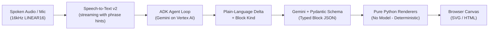

# 🎙️ Live AI Meeting Assistant
### Autonomous Meeting Canvas & Co-Pilot (Google Cloud, ADK, Python)
**Submission for the 5th Agentic AI Hackathon with Google Cloud**

[](https://cloud.google.com/run)
[](https://github.com/google/adk)
[](https://cloud.google.com/vertex-ai)
[](https://fastapi.tiangolo.com)
[](https://cloud.google.com/firestore)

---

## 1. What it does

The **Live AI Meeting Assistant** sits in a meeting, listens to the whole conversation in real-time, and maintains a **live visual canvas** beside the participants — ensuring whatever is discussed is visible, explorable, and correctable while the decision-makers are still in the room.

The agent **decides what to show** without being told which format to pick:
- Someone describes how work runs $\rightarrow$ a **process diagram (`flow`)**, updated as they talk.
- Someone asks a question $\rightarrow$ an **answer card (`answer`)** with confidence ratings and citations.
- Someone weighs named options $\rightarrow$ a **comparison table (`compare`)**.
- Someone agrees to do things $\rightarrow$ an interactive **checklist (`checklist`)**.

### Everything drawn is clickable (Drilling In)
Click a step, a table cell, an answer citation, or a checklist item — anything on the canvas — and the agent explains that specific element in whatever form suits it:
- Clicking a process step can spawn a nested sub-process or detailed explanation attached directly under that node.
- Clicking an element again collapses it.
- Clicking it a third time serves instantly from cache.
- **Voice / Click Parity**: Every action on the canvas can be performed either by clicking or simply asking out loud (*"tell me more about inspection"*, *"undo that"*, *"clear canvas"*).

---

## 2. The Core Architectural Rule: No Model Emits Markup

The pipeline strictly separates reasoning from rendering in three distinct, inspectable stages:



1. **Debuggability**: Stored instructions and validated JSON are inspectable turn-by-turn in Firestore.
2. **Zero Injection Surface**: Python builds markup from strictly validated fields with escaping. No raw HTML from models is ever `innerHTML`'d.
3. **Deterministic Layout**: Python layout ensures no steps are invented or dropped.

---

## 3. Google Cloud Services Used

| Service | Role |
|---|---|
| **Cloud Run** | Single container hosting FastAPI, WebSocket endpoint, ADK agent, and static UI. Scale-to-zero (`--min-instances 0`). |
| **Google ADK (`google-adk`)** | Agent definition, tool registration, and execution loop (`LlmAgent`). |
| **Gemini API via Vertex AI** | Model reasoning (`REASONING_MODEL`) and typed-block JSON synthesis. |
| **Speech-to-Text (v2, streaming)** | 16kHz PCM streaming recognition with phrase hints adaptation. |
| **Text-to-Speech (v1)** | Agent spoken replies and contradiction warnings with echo suppression. |
| **Cloud Firestore** | Real-time session store, block registry, and turn-by-turn audit log (`sessions/{sid}/turns`). |
| **Cloud Storage** | Persistent storage for step illustration icons proxying through `/img/{id}`. |
| **Nano Banana (`IMAGE_MODEL`)** | Flat monochrome line-art icons inside process steps. |

---

## 4. Repository Layout

```
.
├── Dockerfile                  # Container definition for Cloud Run
├── requirements.txt            # Python dependencies (google-adk, google-genai, etc.)
├── .env.example                # Template configuration
├── app/
│   ├── main.py                 # FastAPI: WebSocket, /command, /img/{id}, static mount
│   ├── agent.py                # ADK LlmAgent + tool functions + verbatim instructions
│   ├── models.py               # Central module resolving REASONING_MODEL / IMAGE_MODEL
│   ├── stt.py                  # STT v2 streaming bridged into asyncio
│   ├── tts.py                  # Cloud TTS synthesize -> MP3 bytes
│   ├── commands.py             # Single command registry (voice + click parity)
│   ├── images.py               # Nano Banana -> GCS / local cache -> /img/{id}
│   ├── store.py                # Firestore reads/writes & turn audit logging
│   └── blocks/
│       ├── __init__.py         # BLOCK_REGISTRY: kind -> (schema, renderer)
│       ├── schema.py           # Pydantic models for flow, compare, answer, checklist
│       ├── generate.py         # Instruction + existing block -> typed JSON via Gemini
│       ├── flow.py             # Pure Python SVG renderer
│       ├── compare.py          # Pure Python HTML table renderer
│       ├── answer.py           # Pure Python HTML card renderer
│       └── checklist.py        # Pure Python HTML list renderer
├── static/
│   ├── index.html              # Clean single-page meeting canvas HUD
│   ├── app.js                  # AudioWorklet client, WebSocket, and canvas interactions
│   ├── pcm-worklet.js          # 16kHz Int16 LINEAR16 PCM capture
│   └── style.css               # Responsive design, nested blocks, and animations
└── tests/
    ├── test_blocks.py          # Unit tests for all 4 block schemas and renderers
    └── test_commands.py        # Unit tests for command registry, drilling, and regex
```

---

## 5. Local Setup & Testing

### Prerequisites
- Python 3.11+
- Google Cloud SDK (`gcloud`) authenticated via `gcloud auth login`

### 1. Clone & Configure
```bash
git clone https://github.com/pulliberty11/google-ai-hackathon.git
cd google-ai-hackathon
pip install -r requirements.txt
cp .env.example .env
```

Ensure `.env` contains:
```ini
GOOGLE_CLOUD_PROJECT=your-project-id
GOOGLE_CLOUD_LOCATION=us-central1
GOOGLE_GENAI_USE_VERTEXAI=TRUE
REASONING_MODEL=gemini-2.5-flash
IMAGE_MODEL=gemini-3.1-flash-image
```

### 2. Run Local Server
```bash
uvicorn app.main:app --port 8080 --reload
```

Open **`http://localhost:8080`** in Google Chrome:
1. Click **"Start Mic"** and grant microphone permissions (secure context on localhost).
2. Speak: *"First we take notes, then we show them to the client, then we make decisions."*
3. Watch the SVG process flow diagram render live on screen.
4. Click any node on the canvas to drill into that step.
5. Click it again to collapse it, or click a third time to see it load instantly from cache.

### 3. Run Automated Tests
```bash
python -m pytest tests/
# Or directly:
python tests/test_blocks.py
python tests/test_commands.py
```

---

## 6. Cloud Run Deployment

To deploy to Google Cloud Run:
```bash
gcloud run deploy ai-meeting-assistant \
  --source . \
  --region us-central1 \
  --allow-unauthenticated \
  --timeout 3600 \
  --session-affinity \
  --min-instances 0 \
  --max-instances 3 \
  --cpu-boost \
  --memory 1Gi \
  --set-env-vars GOOGLE_GENAI_USE_VERTEXAI=TRUE,GOOGLE_CLOUD_LOCATION=us-central1,REASONING_MODEL=gemini-2.5-flash,IMAGE_MODEL=gemini-3.1-flash-image
```

---

## 7. License
Apache-2.0. Built for the 5th Agentic AI Hackathon with Google Cloud.
